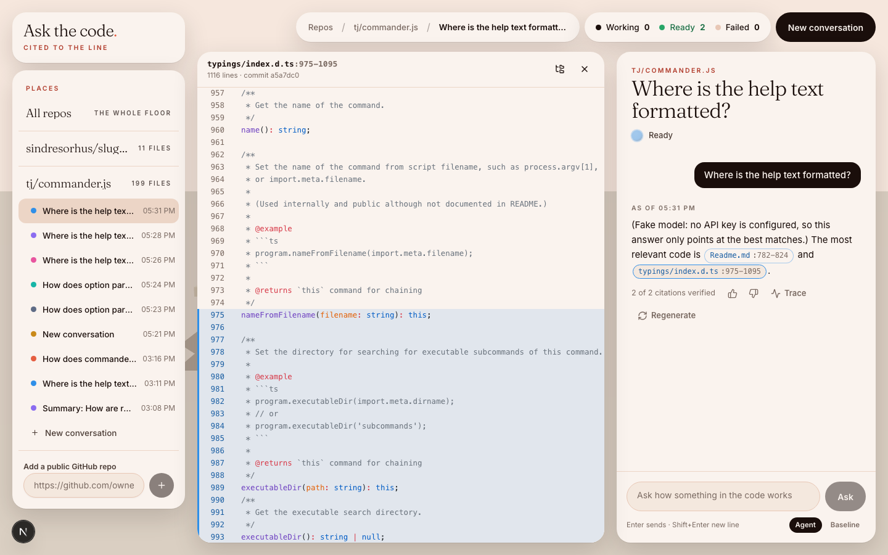
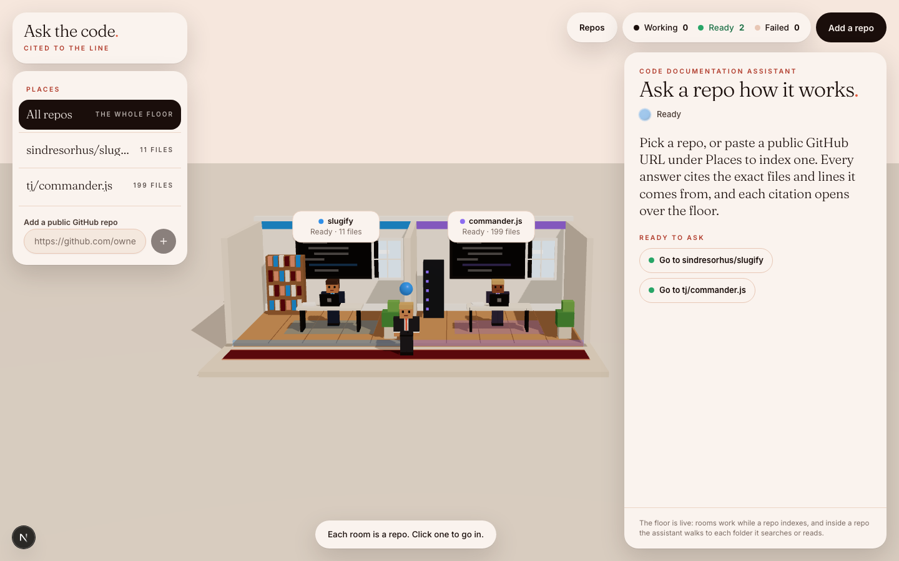
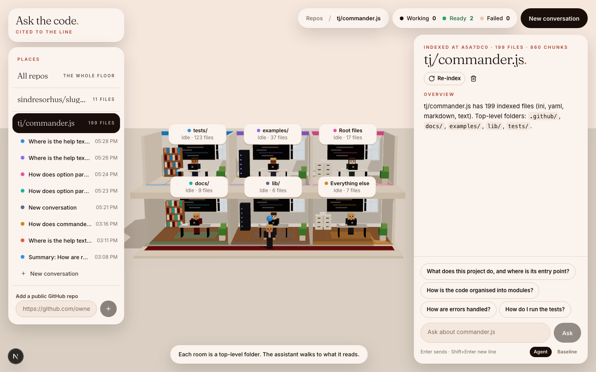
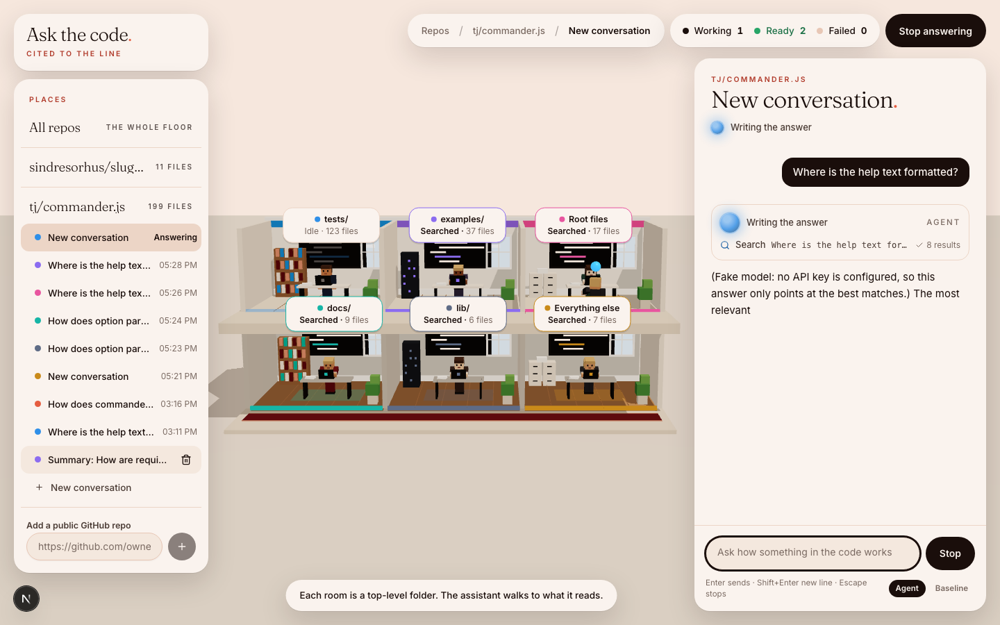
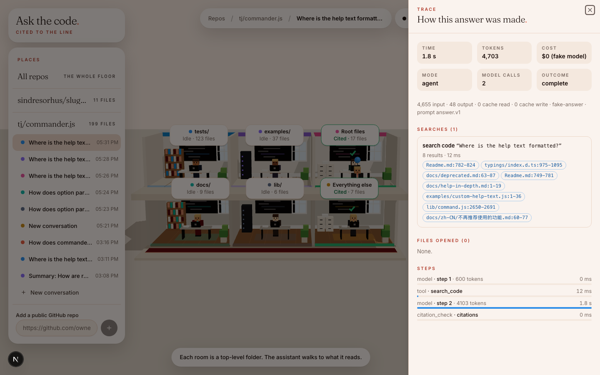
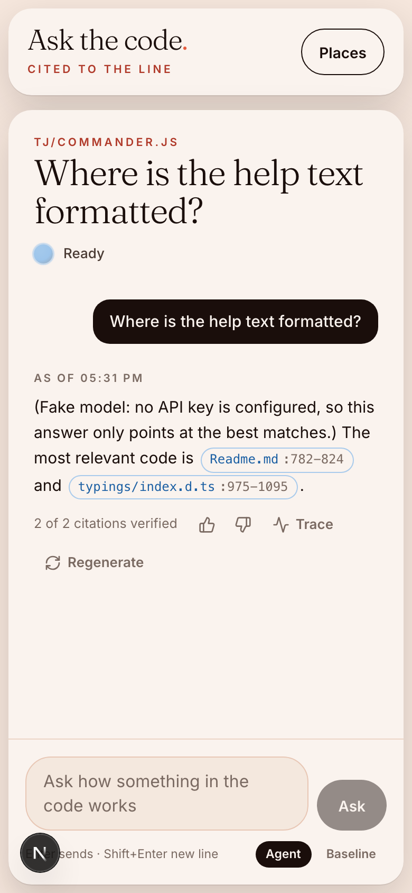
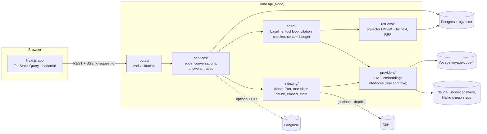

# Code Docs Assistant

Index a public GitHub repo, then ask questions about its code. Answers stream in with `[path:start-end]` citations that are checked in code, and each citation opens the exact lines over the floor. Every answer stores a trace of what was searched and read, with tokens, cost and time.

The UI is the author's White House: a 3D floor with floating cream panels. Each repo is a room; inside a repo each top-level folder is a room, and the assistant (the worker with the orb over their head) walks to the folder each search or file read touches, live from the stream. Folders the answer cites get the house's green tick.



| Repos as rooms | Repo overview | Streaming: folders searched | Trace panel | Narrow screen |
| --- | --- | --- | --- | --- |
|  |  |  |  |  |

Screenshots were taken with the fake model (no API keys), which only points at the best matches.

## Setup

You need Docker. For local development without Docker you need Node 22, pnpm 10 and Postgres with pgvector.

```bash
git clone <this repo> && cd <this repo>
cp .env.example .env          # then set ANTHROPIC_API_KEY and VOYAGE_API_KEY
docker compose up --build
```

- Web: http://localhost:3000
- API: http://localhost:8787 (`GET /health`)

On first start the api runs its migrations, then indexes the sample repo, [tj/commander.js](https://github.com/tj/commander.js) (MIT), pinned to v15.1.0 (`a5a7dc0`). It is ready to query in under a minute.

**No keys?** Set `LLM_PROVIDER=fake` and `EMBEDDING_PROVIDER=fake` in `.env`. Everything runs end to end with deterministic stand-ins: hashed embeddings, and a model that searches once and cites its best matches.

### Local development

```bash
pnpm install
# Postgres with pgvector: DATABASE_URL in .env
pnpm --filter @cda/api dev    # http://localhost:8787, migrates and seeds
pnpm --filter @cda/web dev    # http://localhost:3000
```

## Architecture



**Indexing** runs in the background inside the api process:
1. Validate the URL, then check GitHub for public access and size.
2. Shallow clone, or fetch a single pinned commit.
3. Skip secrets, lock files, binaries, vendored code, build output and oversized files.
4. Chunk: tree-sitter, one chunk per function, class or method, with large classes split by method; markdown by heading; line windows for everything else.
5. Embed in batches through a cache keyed by content hash and model.
6. Write a new index version tied to the commit, swap it in with one transaction and delete the old one.
7. Write the overview and suggested questions with the cheap model.

A re-index copies unchanged files' chunks and vectors in SQL, and chunks and embeds only changed files.

**Answering** has two modes, chosen per question in the UI or with `ANSWER_MODE`:
- **Baseline:** one hybrid search (pgvector cosine and Postgres full text, merged with reciprocal rank fusion), with the top 8 chunks sent to one Sonnet call.
- **Agent:** a plain-code loop with four read-only tools (`search_code`, `find_symbol`, `read_file`, `list_files`) and at most 6 steps; the last step is forced to answer.

Both stream over SSE. Afterwards, every citation is checked: the file exists, the lines are in range, and the lines were retrieved during this run. An answer with no valid citation is stored as "not found", together with what was searched.

## Environment variables

All are validated at start-up (`apps/api/src/config.ts`); `.env.example` has every one.

| Variable | Default | Purpose |
| --- | --- | --- |
| `LLM_PROVIDER` | `anthropic` | `anthropic` or `fake` |
| `ANTHROPIC_API_KEY` | | Required when `LLM_PROVIDER=anthropic` |
| `ANSWER_MODEL` | `claude-sonnet-5-5` | Answers and the eval judge |
| `CHEAP_MODEL` | `claude-haiku-5-5` | Overviews, titles, conversation summaries |
| `EMBEDDING_PROVIDER` | `voyage` | `voyage` or `fake` |
| `VOYAGE_API_KEY` | | Required when `EMBEDDING_PROVIDER=voyage` |
| `EMBEDDING_MODEL` | `voyage-code-4` | Must output 1024 dimensions |
| `ANSWER_MODE` | `agent` | Default mode when the client does not pick one |
| `DATABASE_URL` | | Postgres with pgvector |
| `PORT` | `8787` | API port |
| `CORS_ORIGIN` | `http://localhost:3000` | Web origin allowed to call the api |
| `NEXT_PUBLIC_API_URL` | `http://localhost:8787` | API URL baked into the web build |
| `LOG_LEVEL` | `info` | pino level |
| `GITHUB_TOKEN` | | Optional; raises the GitHub API rate limit |
| `SEED_SAMPLE_REPO` | `true` in compose | Index the sample repo on start |
| `SAMPLE_REPO_URL`, `SAMPLE_REPO_COMMIT` | commander.js @ `a5a7dc0` | The pinned sample |
| `MAX_REPO_SIZE_MB` | `100` | GitHub-reported size, and total indexable bytes |
| `MAX_FILE_COUNT` | `3000` | Indexable files per repo |
| `MAX_FILE_BYTES` | `300000` | Larger files are skipped |
| `MAX_AGENT_STEPS` | `6` | Model calls per agent answer (1 to 6) |
| `MAX_TOKENS_PER_ANSWER` | `120000` | Token cap per answer; when reached, the next step must answer |
| `RATE_LIMIT_PER_MINUTE` | `20` | Per client, on asking questions and adding repos |
| `FAKE_STREAM_DELAY_MS` | `0` | Fake model only: delay per streamed word |
| `LANGFUSE_PUBLIC_KEY`, `LANGFUSE_SECRET_KEY`, `LANGFUSE_HOST` | | Optional trace export (OTLP) |
| `TEST_DATABASE_URL` | | Tests: use this server instead of Testcontainers |
| `E2E_DATABASE_URL` | | Browser test database |

## Tests and evals

```bash
pnpm lint && pnpm typecheck
pnpm test      # unit + integration (real Postgres via Testcontainers, fake model)
pnpm e2e       # Playwright: the main journey in a browser (needs Postgres and GitHub access)
pnpm eval      # golden set: retrieval metrics, plus baseline vs agent answers when keys are set
```

- Tests never call a real model.
- Integration tests start `pgvector/pgvector:pg17` with Testcontainers, or use `TEST_DATABASE_URL` if it is set.
- `pnpm eval` writes `docs/eval-results.md`.
- CI (`.github/workflows/ci.yml`) runs lint, types, tests, the retrieval eval (failing if hybrid Recall@10 drops below 0.6) and the browser test.

## Eval results

34 questions on the pinned sample repo, of five types: find, explain, multi-step, unanswerable and prompt injection. The golden set is an unreviewed draft (`apps/api/src/evals/golden-set.json`). The table below was produced without API keys (fake embeddings), so it measures the retrieval plumbing, not Voyage quality:

| Search | Recall@5 | Recall@10 | MRR@10 |
| --- | --- | --- | --- |
| vector | 37.2% | 60.6% | 0.282 |
| keyword | 32.8% | 44.4% | 0.197 |
| hybrid | 51.1% | 66.1% | 0.344 |

The answer-quality comparison (baseline vs agent: citation validity, judged correctness and faithfulness, cost, p50/p95 latency) needs `ANTHROPIC_API_KEY` and `VOYAGE_API_KEY`. Run `pnpm eval` with keys to fill in `docs/eval-results.md`.

## Known gaps and unhandled edge cases

- **Not run against real providers.** No keys were available while building, so Claude, Voyage and Langfuse were never called. Their clients follow the current SDK and API docs, and answer quality, prompt-cache hit rates and costs are unmeasured.
- **Docker untested here.** `docker compose up` and the Testcontainers path were written but could not be run on the build machine (the Docker daemon would not start). Tests ran against a local Postgres 18 + pgvector 0.8.7.
- **Indexing jobs live in the api process.** A restart marks running jobs failed (the user can retry), and there is no cross-instance coordination.
- The rate limiter is in memory and per process, keyed by client address (behind a proxy everyone shares one key).
- Very large single files (over 2,000 lines) render without virtualisation in the code viewer, and files over 400 KB are not highlighted.
- Git LFS files, submodules and symlinks are not followed. Non-UTF-8 text files are decoded as UTF-8.
- A model citing a range that only partly overlaps retrieved code is accepted as valid; the checker tests overlap, not containment.
- The eval judge is the same model family as the answerer, which flatters it. The golden set has not been reviewed by a human yet.
- Prompt injection is defended by labelling repo content as data and by the citation checker, not by a classifier.

## RAG and LLM decisions

<!--
Facts from the build:
- Chunking: tree-sitter (@vscode/tree-sitter-wasm, 15 grammars), one chunk per function/class/method, classes over 150 lines split by member as Class.method, leading doc comments attached; markdown by heading; 60-line windows with 10 overlap otherwise. Chunk text embedded with "path: ... / symbol: ..." prefix.
- Embeddings: voyage-code-4, 1024 dims, input_type document/query; cache keyed by sha256(embedded text) + model.
- Retrieval: pgvector HNSW cosine (iterative_scan = relaxed_order so the per-version filter cannot starve results) + Postgres FTS ('simple' config, identifiers split into words, path/symbol weighted A over body D, ts_rank_cd normalisation 1), fused with RRF k=60, 30 candidates each.
- Measured with fake embeddings: hybrid beats either alone (R@10 66.1% vs 60.6% vector, 44.4% keyword); weighting path/symbol raised keyword R@5 24.4% -> 32.8% and hybrid MRR .328 -> .344.
- Two modes kept: baseline (one search, top 8) and agent (4 read-only tools, 6 steps, last step tool_choice none, token cap, append-only tool-output budget 140k chars).
- Models: Sonnet 5.5 effort medium for answers with server-side refusal fallbacks; Haiku 5.5 effort low for overview/title/summary; thinking left adaptive.
- Prompts versioned (answer.v1, overview.v1, conversation.v1, judge.v1); fixed rules + overview cached; repo text wrapped in <repo_data> and labelled untrusted.
- Citation checker in code: file exists in version, range in bounds, overlaps evidence retrieved in this run; zero valid citations or NOT_FOUND => stored as not_found with searches listed.
- Conversation memory: last 6 turns in full, older folded into a rolling summary by the cheap model after answers.
-->

## Key technical decisions

<!--
Facts from the build:
- pnpm monorepo: apps/web (Next 16, React 19, Tailwind 4, shadcn/ui, TanStack Query), apps/api (Hono on Node 22, run with tsx), packages/shared (zod contracts used by both, including the SSE event union).
- Postgres is the only datastore: vectors, full text, jobs, traces. No queue: in-process runner with concurrency 2, job state in index_jobs, interrupted jobs marked failed on boot.
- Index versions tied to commit sha; atomic swap in one transaction; re-index copies unchanged files/chunks/vectors with two INSERT...SELECT statements.
- Browser talks to the api directly (CORS) so SSE is never buffered by a proxy; Stop = abort fetch, server sees disconnect, aborts the model call, stores partial answer as stopped.
- Providers behind interfaces with fakes; one composition root (services/container.ts).
- Langfuse via its OTLP endpoint (ingestion API is legacy), no SDK.
- UI from the author's White House app: its FloorScene and Person (three.js via react-three-fiber) are reused for a 3D floor where repos and folders are rooms, and its chrome (Places card, status pills, Chief of Staff panel, hint pill) frames the chat. Tokens in a single theme file; the orb is CSS in the panel and a glowing sphere over the assistant, both driven by real stream states.
-->

## Engineering standards followed and skipped

<!--
Facts from the build:
- Followed: strict TS everywhere, no any / no non-null assertions (lint-enforced), zod at every boundary (env, HTTP bodies/params, provider responses, SSE frames, tool inputs), typed AppError with user-facing messages, pino JSON logs with request id from web to api, secrets redacted, no file contents logged or exported, tests with fakes, integration tests on real Postgres, CI for lint/types/tests/retrieval eval/e2e.
- 98 api tests, 8 web unit tests, 1 shared test, 2 Playwright tests.
- Skipped or partial: Docker compose and Testcontainers not executed locally (daemon unavailable); a few long-ish functions (runIndexJob ~60 lines, useAnswerStream); one cast at the Anthropic replay boundary; no load testing; golden set unreviewed.
-->

## How AI tools were used

<!--
Facts from the build:
- Built end to end by Claude Code (Claude Opus 5.5) from docs/BUILD.md, phase by phase, with a self-review and commit per phase; every choice and deviation is in docs/ai-log.md.
- Sub-agents: one extracted design tokens from the White House source (docs/design/source-notes.md), one drafted the 34-question golden set from the commander.js source with line evidence.
- Model ids and SDK usage checked against the bundled Claude API docs; Voyage model and Langfuse endpoint checked on the web.
-->

## What I would do differently

<!--
Facts from the build:
- Run the real-model evals before tuning anything else; tune top-k, chunk size and the agent prompt against them.
- A reranker over fused candidates, and query rewriting for follow-ups, were left out to keep it simple.
- The in-process job runner and rate limiter are the first things to move out for more than one instance.
-->

## Productionising

<!--
Facts from the build:
- Needed: auth and per-user data, a durable job queue with retries, a shared rate limiter, object storage or git cache for clones, secrets manager, migrations as a deploy step, HNSW tuning and partitioning by repo at scale, embedding re-index on model change (already keyed by model), cost budgets per user, online eval from feedback (feedback is stored against traces), alerting on citation-failure rate.
-->
